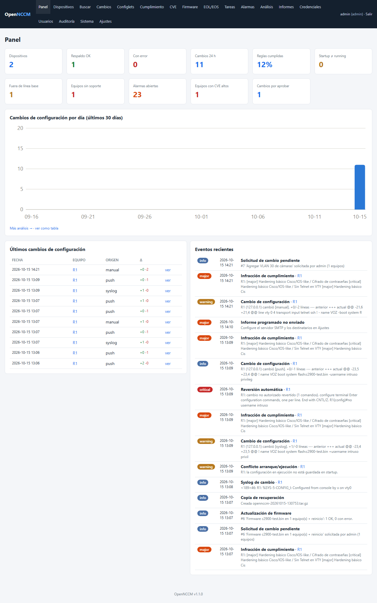
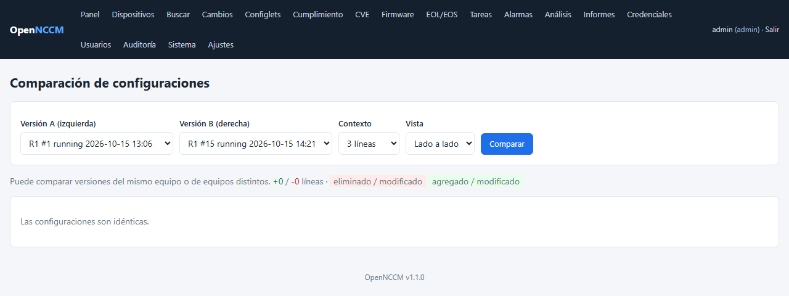

# OpenNCCM

[](https://github.com/Gaaraalex/opennccm/actions/workflows/ci.yml)
[](https://github.com/Gaaraalex/opennccm/releases)
[](LICENSE)

**Gestión de configuración, cambios y cumplimiento de red (NCCM) de código abierto para Ubuntu Server.**
Respalda, versiona, compara y audita la configuración de switches, routers y firewalls de **unos 70 fabricantes
(122 plataformas)**, detecta los cambios en tiempo real, controla quién puede cambiar qué y vuelve atrás cuando algo sale mal.



## Instalación

En un Ubuntu Server **22.04 o 24.04** recién instalado:

```bash
curl -fsSL https://raw.githubusercontent.com/Gaaraalex/opennccm/main/install.sh | sudo bash
```

Un asistente con menús comprueba el servidor, actualiza Ubuntu, instala lo que falte y le pregunta
la dirección del servidor, la zona horaria, el tipo de HTTPS, la base de datos, el cortafuegos, la contraseña del
administrador y (opcional) el correo para alertas. Al terminar muestra la dirección y las credenciales.

**Instalación desatendida** (sin preguntas, para automatizar):

```bash
curl -fsSL https://raw.githubusercontent.com/Gaaraalex/opennccm/main/install.sh | \
  sudo bash -s -- --unattended --host 10.0.0.5 --admin-pass 'UnaClaveSegura123'
```

Todas las opciones: `sudo bash install.sh --help` (HTTPS con Let's Encrypt o certificado propio, PostgreSQL,
cortafuegos, correo, versión concreta…).

## Actualizar

```bash
sudo opennccm update
```

Busca la última versión publicada, muestra las novedades, guarda una copia previa (código + base de datos),
actualiza y verifica que arranque. **Si la versión nueva no responde, vuelve sola a la anterior.**
Para volver atrás manualmente: `sudo opennccm rollback`.

## Comandos

| Comando | Acción |
|---|---|
| `opennccm status` | Estado, versión, dirección y si hay actualizaciones |
| `sudo opennccm update [--check]` | Actualizar (o solo comprobar) |
| `sudo opennccm rollback` | Volver a la versión anterior |
| `sudo opennccm backup [--with-key]` | Copia de recuperación |
| `sudo opennccm restore ARCHIVO` | Restaurar una copia |
| `sudo opennccm reset-password USUARIO CLAVE` | Cambiar contraseña / crear administrador |
| `opennccm logs [-f]` | Registro del servicio |
| `sudo opennccm uninstall [--purge]` | Desinstalar |

## Funciones

| | |
|---|---|
| **Respaldos** | Manuales, programados y automáticos al detectar un cambio por syslog; running y startup; cifrados AES-256 |
| **Versiones y comparación** | Historial completo, etiquetas, línea base y comparación lado a lado |
| **Cambios** | Configlets (plantillas Jinja2) masivos, solicitudes con aprobación, reversión manual o automática |
| **Cumplimiento** | Políticas con reglas y corrección; paquetes PCI DSS 4.0, HIPAA, SOX y hardening Cisco IOS / Junos |
| **Firmware** | Repositorio de imágenes y actualización remota (SCP + verificación MD5 + arranque + reinicio) |
| **Seguridad** | Vulnerabilidades de firmware (CVE de NVD), fin de vida EOL/EOS (CSV o API Cisco EoX) |
| **Operación** | Tareas programadas, alarmas por severidad, correo / Teams / Slack / Telegram |
| **Análisis e informes** | Gráficas, informes en pantalla, CSV y envío programado por correo |
| **Acceso** | Roles admin / operador / lector, restricción por grupos de equipos, auditoría completa |
| **Recuperación** | Copias de la base de datos, SFTP remoto, restauración y actualización con vuelta atrás |

<p>


</p>

## Fabricantes

Cisco (IOS, IOS-XE, NX-OS, IOS-XR, ASA, FTD, WLC, C9800, Small Business, vEdge), Juniper, Arista, HPE/Aruba, H3C,
Huawei, Fortinet, Palo Alto, Check Point, Sophos, F5, Citrix, A10, WatchGuard, Hillstone, MikroTik, Dell, Extreme,
Avaya/Nortel, Brocade, Ruckus, Nokia, Alcatel-Lucent, Ciena, ADVA, Adtran, Calix, Ericsson, NVIDIA (Cumulus/Mellanox),
D-Link, Netgear, FS, Hirschmann, Moxa, Ubiquiti, TP-Link, ZTE, Ruijie, VyOS y muchos más, sobre
[Netmiko](https://github.com/ktbyers/netmiko). Cualquier otro equipo con SSH se gestiona con el perfil genérico.
Lista completa en la página **Plataformas** de la aplicación.

## Documentación

- 📘 [Guía de instalación en Ubuntu (PDF)](docs/OpenNCCM-Guia-de-instalacion.pdf)
- 📗 [Manual de funciones (PDF)](docs/OpenNCCM-Manual-de-funciones.pdf)
- 📝 [Historial de versiones](CHANGELOG.md)

## Requisitos

| Equipos | CPU | RAM | Disco |
|---|---|---|---|
| hasta 300 | 2 vCPU | 4 GB | 40 GB |
| 300 – 2 000 | 4 vCPU | 8 GB | 100 GB |
| más de 2 000 | 8 vCPU | 16 GB | 200 GB + PostgreSQL |

Puertos: TCP 443 (web), UDP 514 (syslog desde los equipos); salida a los equipos por TCP 22.

## Desarrollo

```bash
python3 -m venv .venv && .venv/bin/pip install -r requirements.txt
bash tests/run-tests.sh .venv/bin/python     # pruebas de extremo a extremo con un router Cisco simulado
```

Cada cambio se prueba automáticamente en Ubuntu 22.04 y 24.04: aplicación, instalación desatendida,
asistente con menús, actualización, vuelta atrás y recuperación ante una versión rota.
Las versiones se publican con una etiqueta `vX.Y.Z`. Ver [CONTRIBUTING.md](CONTRIBUTING.md).

## Licencia

[GPL-3.0](LICENSE). Puede usar, estudiar, modificar y distribuir OpenNCCM; si distribuye versiones modificadas,
debe publicarlas con la misma licencia.
