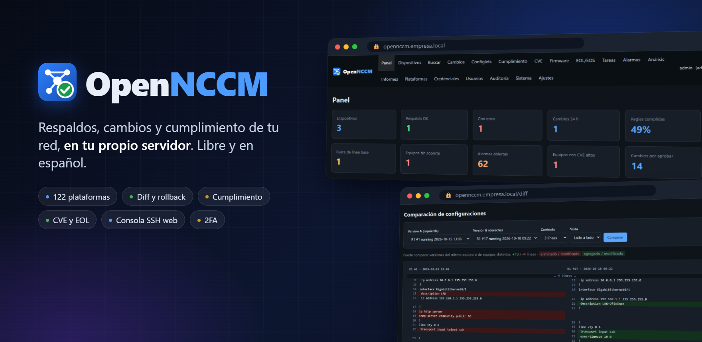
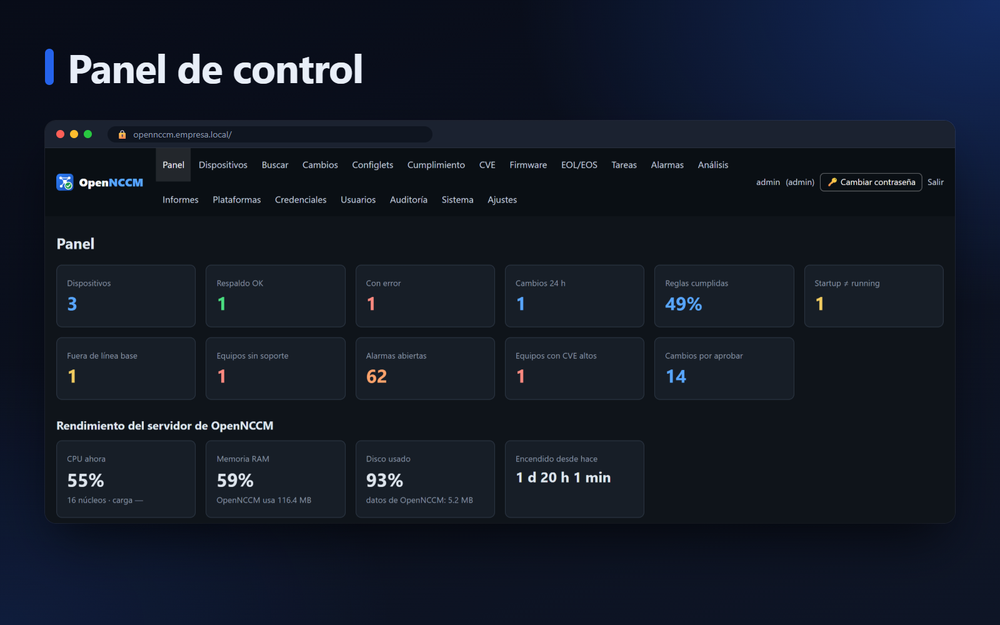
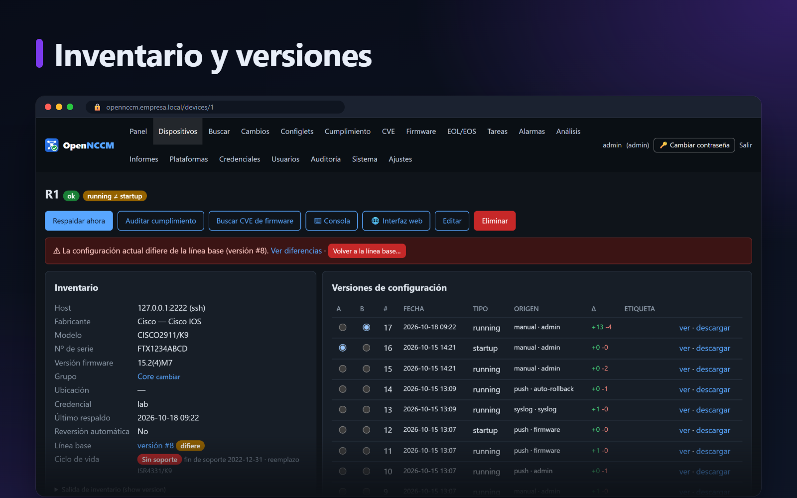
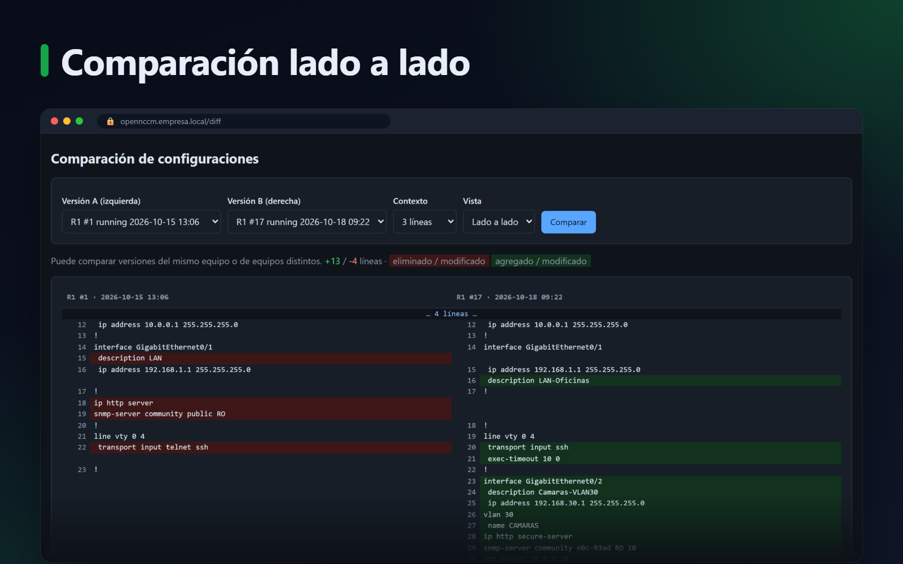
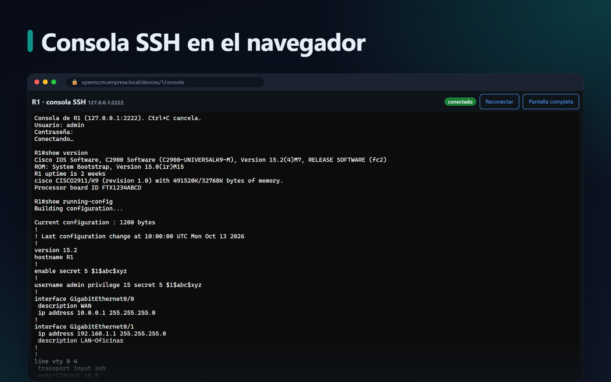
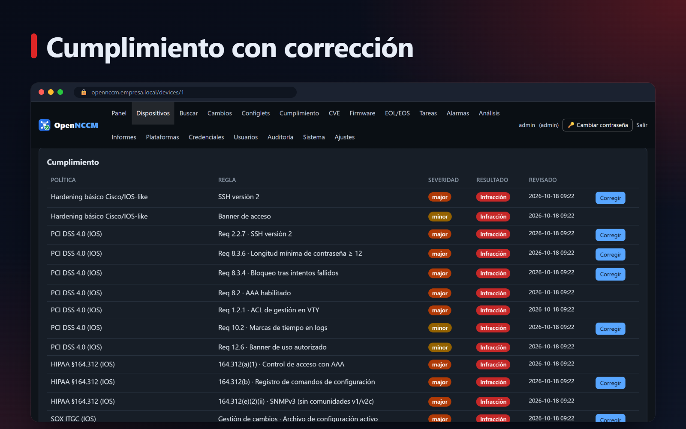
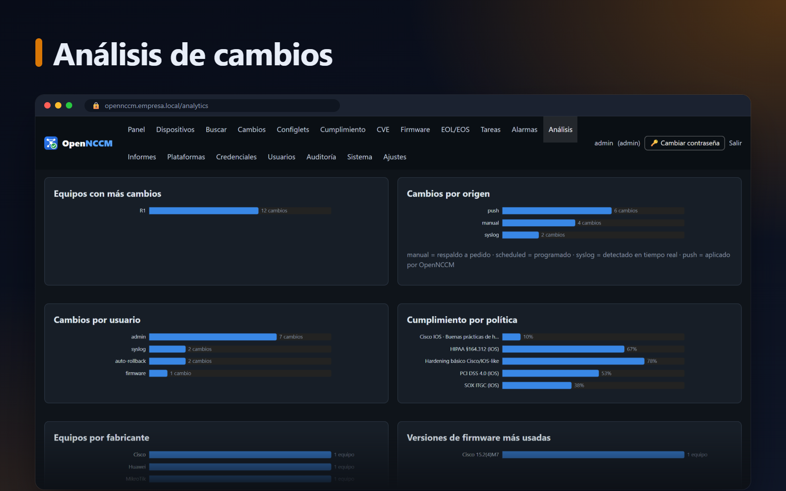

<p align="center">
  
</p>

<p align="center">
  <a href="https://github.com/Gaaraalex/opennccm/actions/workflows/ci.yml"></a>
  <a href="https://github.com/Gaaraalex/opennccm/releases"></a>
  <a href="LICENSE"></a>
  
  
</p>

<p align="center">
  <b>Gestión de configuración, cambios y cumplimiento de red (NCCM) de código abierto para Ubuntu Server.</b><br>
  Respalda, versiona, compara y audita switches, routers y firewalls de unos 70 fabricantes,<br>
  detecta los cambios en tiempo real, controla quién cambia qué y vuelve atrás cuando algo sale mal.
</p>

<p align="center">
  <a href="#-instalación"><b>Instalar</b></a> ·
  <a href="#-qué-hace"><b>Funciones</b></a> ·
  <a href="#-documentación"><b>Documentación</b></a> ·
  <a href="CHANGELOG.md"><b>Novedades</b></a>
</p>

---

## ✨ Así se ve

<table>
  <tr>
    <td width="50%"></td>
    <td width="50%"></td>
  </tr>
  <tr>
    <td>📊 <b>Panel de control</b>: el estado de toda la red de un vistazo y el rendimiento del propio servidor.</td>
    <td>🗂️ <b>Inventario y versiones</b>: modelo, serie y firmware, con el historial completo de cada configuración.</td>
  </tr>
  <tr>
    <td></td>
    <td></td>
  </tr>
  <tr>
    <td>🔍 <b>Comparación lado a lado</b>: qué cambió, cuándo y quién, entre versiones o entre equipos distintos.</td>
    <td>🖥️ <b>Consola SSH en el navegador</b>: entra al equipo sin instalar nada, en una ventana aparte y con auditoría.</td>
  </tr>
  <tr>
    <td></td>
    <td></td>
  </tr>
  <tr>
    <td>🛡️ <b>Cumplimiento</b>: PCI DSS, HIPAA, SOX y hardening, con corrección en un clic (y aprobación si se exige).</td>
    <td>📈 <b>Análisis</b>: quién cambia más, por qué vía, qué cumple y qué firmware hay en la red.</td>
  </tr>
</table>

<p align="center">
  
</p>

## 🚀 Instalación

En un Ubuntu Server **22.04 o 24.04** recién instalado:

```bash
curl -fsSL https://raw.githubusercontent.com/Gaaraalex/opennccm/main/install.sh -o install.sh && sudo bash install.sh
```

Un asistente con menús comprueba el servidor, actualiza Ubuntu, instala lo que falte y le pregunta
la dirección del servidor, la zona horaria, el tipo de HTTPS, la base de datos, el cortafuegos, la contraseña del
administrador y (opcional) el correo para alertas. Al terminar muestra la dirección y las credenciales.

> [!TIP]
> Con el certificado propio, abra `https://SERVIDOR/certificado` e instale la autoridad de OpenNCCM en su PC:
> el navegador deja de mostrar avisos y le ofrece guardar la contraseña.

<details>
<summary><b>Instalación desatendida</b> (sin preguntas, para automatizar)</summary>

```bash
curl -fsSL https://raw.githubusercontent.com/Gaaraalex/opennccm/main/install.sh | \
  sudo bash -s -- --unattended --host 10.0.0.5 --admin-pass 'UnaClaveSegura123'
```

Todas las opciones: `sudo bash install.sh --help` (HTTPS con Let's Encrypt o certificado propio, PostgreSQL,
cortafuegos, correo, versión concreta…).
</details>

## 🔄 Actualizar

Desde la web: **Sistema → Actualizar** (el panel avisa cuando hay una versión nueva y muestra sus novedades).
O desde la consola del servidor:

```bash
sudo opennccm update
```

Antes de actualizar guarda una copia (código + base de datos) y después verifica que la aplicación arranque.
**Si la versión nueva no responde, vuelve sola a la anterior.** Para volver atrás a mano: `sudo opennccm rollback`.

## 🧭 Qué hace

| | |
|---|---|
| 💾 **Respaldos** | Manuales, programados y automáticos al detectar un cambio por syslog; running y startup; cifrados AES-256 |
| 🔍 **Versiones y comparación** | Historial completo, etiquetas, línea base, comparación lado a lado o unificada |
| 🛠️ **Cambios** | Configlets (plantillas Jinja2) masivos, solicitudes con aprobación, reversión manual o automática |
| 🛡️ **Cumplimiento** | Políticas con reglas y corrección; paquetes PCI DSS 4.0, HIPAA, SOX y hardening Cisco IOS / Junos |
| 📦 **Firmware** | Repositorio de imágenes y actualización remota (SCP + verificación MD5 + arranque + reinicio) |
| 🚨 **Vulnerabilidades** | CVE de firmware (NVD) y fin de vida EOL/EOS (CSV o API Cisco EoX) |
| 🖥️ **Consola web** | SSH al equipo desde el navegador, en ventana aparte, con inicio de sesión automático opcional y auditoría |
| ⏰ **Operación** | Tareas programadas sin escribir cron, alarmas por severidad, correo / Teams / Slack / Telegram |
| 📈 **Análisis e informes** | Gráficas, informes en pantalla, CSV y envío programado por correo |
| 🔐 **Acceso y seguridad** | Roles admin / operador / lector, grupos de equipos, verificación en dos pasos (TOTP), auditoría completa |
| 🎨 **Interfaz** | 10 temas (más el automático), adaptable al teléfono, accesible (contraste WCAG AA) |
| ♻️ **Recuperación** | Copias cifradas de la base de datos, SFTP remoto, restauración y actualización con vuelta atrás |

## ⌨️ Comandos

| Comando | Acción |
|---|---|
| `opennccm status` | Estado, versión, dirección y si hay actualizaciones |
| `sudo opennccm update [--check]` | Actualizar (o solo comprobar) |
| `sudo opennccm rollback` | Volver a la versión anterior |
| `sudo opennccm backup [--with-key]` | Copia de recuperación |
| `sudo opennccm restore ARCHIVO` | Restaurar una copia |
| `sudo opennccm users` | Listar usuarios |
| `sudo opennccm reset-password USUARIO CLAVE` | Cambiar contraseña / crear administrador |
| `sudo opennccm reset-2fa USUARIO` | Quitar la verificación en dos pasos (teléfono perdido) |
| `opennccm logs [-f]` | Registro del servicio |
| `sudo opennccm uninstall [--purge]` | Desinstalar |

## 🌐 Fabricantes

Cisco (IOS, IOS-XE, NX-OS, IOS-XR, ASA, FTD, WLC, C9800, Small Business, vEdge), Juniper, Arista, HPE/Aruba, H3C,
Huawei, Fortinet, Palo Alto, Check Point, Sophos, F5, Citrix, A10, WatchGuard, Hillstone, MikroTik, Dell, Extreme,
Avaya/Nortel, Brocade, Ruckus, Nokia, Alcatel-Lucent, Ciena, ADVA, Adtran, Calix, Ericsson, NVIDIA (Cumulus/Mellanox),
D-Link, Netgear, FS, Hirschmann, Moxa, Ubiquiti, TP-Link, ZTE, Ruijie, VyOS y muchos más, sobre
[Netmiko](https://github.com/ktbyers/netmiko). Cualquier otro equipo con SSH se gestiona con el perfil genérico.
Lista completa en la página **Plataformas** de la aplicación.

## 📚 Documentación

- 📘 [Guía de instalación en Ubuntu (PDF)](docs/OpenNCCM-Guia-de-instalacion.pdf)
- 📗 [Manual de funciones (PDF)](docs/OpenNCCM-Manual-de-funciones.pdf)
- 📝 [Historial de versiones](CHANGELOG.md)

## 🖧 Requisitos

| Equipos | CPU | RAM | Disco |
|---|---|---|---|
| hasta 300 | 2 vCPU | 4 GB | 40 GB |
| 300 – 2 000 | 4 vCPU | 8 GB | 100 GB |
| más de 2 000 | 8 vCPU | 16 GB | 200 GB + PostgreSQL |

Puertos: TCP 443 (web), UDP 514 (syslog desde los equipos); salida a los equipos por TCP 22.

## 🧪 Desarrollo

```bash
python3 -m venv .venv && .venv/bin/pip install -r requirements.txt
bash tests/run-tests.sh .venv/bin/python     # pruebas de extremo a extremo con un router Cisco simulado
```

Cada cambio se prueba automáticamente en Ubuntu 22.04 y 24.04: aplicación, instalación desatendida,
asistente con menús, actualización (también desde la web), vuelta atrás y recuperación ante una versión rota.
Las versiones se publican con una etiqueta `vX.Y.Z`. Ver [CONTRIBUTING.md](CONTRIBUTING.md).

## 📄 Licencia

[GPL-3.0](LICENSE). Puede usar, estudiar, modificar y distribuir OpenNCCM; si distribuye versiones modificadas,
debe publicarlas con la misma licencia.
